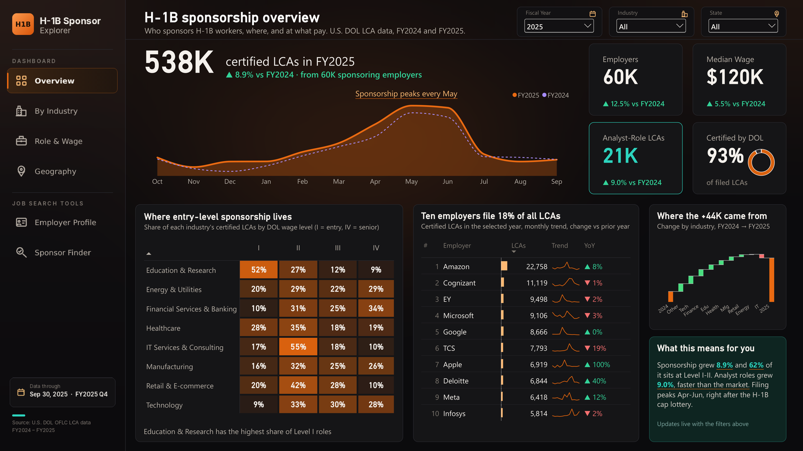
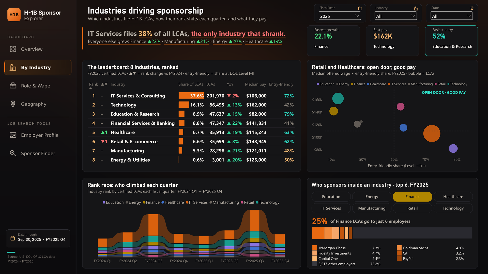
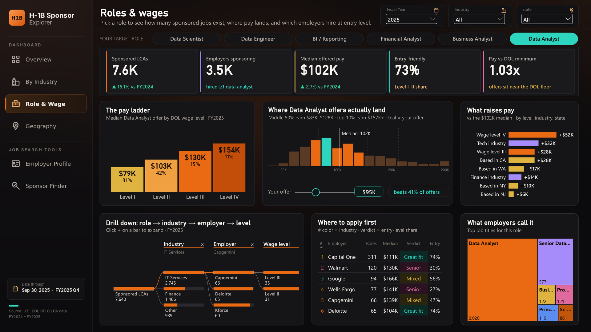
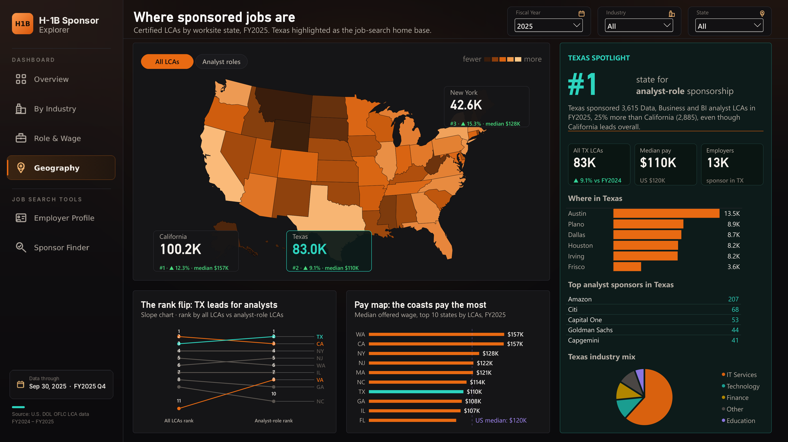
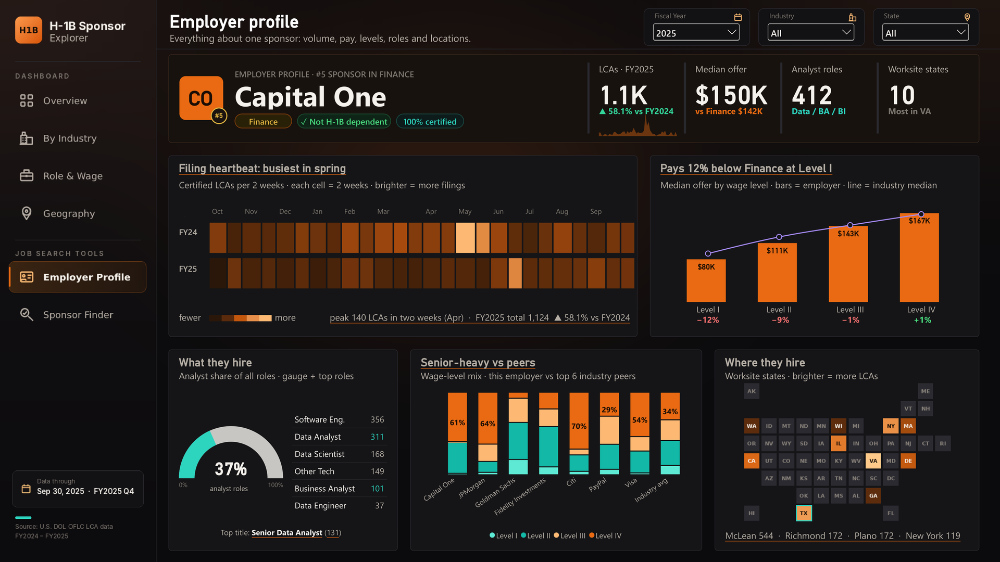
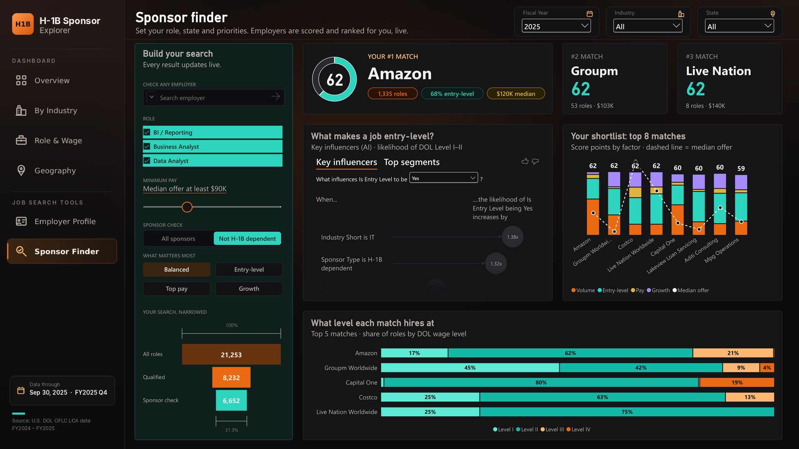

# H-1B Sponsor Explorer

**Which companies, industries, roles and locations sponsor H-1B workers, at what pay, and how did that change from FY2024 to FY2025?**

An end-to-end analytics project built on **1.1 million U.S. Department of Labor H-1B filings**: Python for preprocessing, PostgreSQL for cleaning and modeling, and a 6-page interactive Power BI dashboard. It works as a market-intelligence report on H-1B sponsorship and also as a practical job-search tool for international candidates.



---

## Business questions

1. How large is H-1B sponsorship, and is it growing?
2. Which industries and employers drive it, and which are the most entry-level friendly?
3. For a target role (Data Analyst, Business Analyst, BI), what does pay look like at each DOL wage level, and what raises it?
4. Where are sponsored jobs located, and how does Texas compare?
5. For any single employer: how much, when, at what level and where do they sponsor?
6. Given my role, minimum pay and priorities, which employers should I apply to first?

## Data

- **Source:** [U.S. DOL Office of Foreign Labor Certification, LCA Disclosure Data](https://www.dol.gov/agencies/eta/foreign-labor/performance)
- **Scope:** 8 quarterly files (FY2024 Q1 to FY2025 Q4, Oct 2023 to Sep 2025), H-1B cases only
- **Size:** 1,118,768 rows after deduplication

Raw files are not included in this repo because of their size. See [How to reproduce](#how-to-reproduce).

## Tools and pipeline

| Step | Tool | What it does |
|---|---|---|
| 1. Preprocess | Python (pandas) | Combines the 8 Excel files, keeps the needed columns and H-1B cases, cleans text, dates and wages, removes duplicate case numbers, writes one clean CSV |
| 2. Stage | PostgreSQL / pgAdmin | Loads the CSV into a staging table (`h1b.stg_lca`) |
| 3. Model | SQL | Builds a typed table with annualized wages, wage-to-prevailing-wage ratios and outlier flags; cleans employer names and groups 130 name patterns into 115 companies; maps industries (NAICS prefix plus the lookup); classifies job titles into role families; and exposes the view `h1b.vw_lca_dashboard` |
| 4. Visualize | Power BI Desktop | Imports the view (Import mode with refresh), 200+ DAX measures, 6 report pages |

## Dashboard

### 1. Overview
Total certified LCAs with year-over-year change, monthly filing trend vs prior year, an entry-level heatmap by industry and wage level, the top 10 sponsors with sparklines, and a waterfall showing which industries drove the change.

### 2. By Industry
A leaderboard of 8 industries with rank change, share, growth, median pay and entry-friendliness, a pay vs entry-friendliness scatter, a ribbon chart of quarterly rank changes, and a drill into the top 6 sponsors inside any industry.



### 3. Role & Wage
Pick a target role to see sponsored LCAs, median offer, the pay ladder by DOL wage level, the offer distribution with a "your offer" slider, what raises pay, a role → industry → employer → level decomposition tree, and where to apply first.



### 4. Geography
A state map with All LCAs / Analyst roles toggle, a slope chart of state ranks, median pay by state, and a Texas spotlight (cities, top analyst sponsors, industry mix).



### 5. Employer Profile (drill-through)
Right-click any employer on another page to open its profile: rank in its industry, filing "heartbeat" heatmap by fortnight, pay vs industry median at each level, what roles they hire, wage-level mix vs top industry peers, and a worksite tile map built with a Python visual.



### 6. Sponsor Finder
Set role, minimum pay, sponsor type and priorities (Balanced, Entry-level, Top pay, Growth). Every employer gets a 0-100 match score from volume, entry-level share, pay and growth, with the top 3 matches, a scored shortlist of 8, an AI Key Influencers visual on what makes a job entry-level, and a funnel showing how the search narrows.



A PDF of all six pages is in [`dashboard/H1B_Sponsor_Explorer.pdf`](dashboard/H1B_Sponsor_Explorer.pdf).

## Key findings (FY2025, all states)

- **Sponsorship grew.** 538K certified LCAs, up 8.9% from FY2024, from about 60K sponsoring employers (up 12.5%). Median offered wage was $120K (up 5.5%), and 93% of filed LCAs were certified.
- **Filing is seasonal.** Filings peak every May, right after the H-1B cap lottery.
- **IT Services is the largest industry but the only one that shrank.** It files 38% of all LCAs and fell 2%. Finance (up 22%), Manufacturing (up 21%), Energy (up 20%) and Healthcare (up 19%) grew fastest.
- **Sponsorship is concentrated.** The top 10 employers file 18% of all LCAs. Amazon alone filed 22,758.
- **Education & Research is the easiest entry point.** 52% of its LCAs are at DOL Level I and 79% at Level I-II, though its median pay ($82K) is the lowest. Technology pays the most ($162K median).
- **Data Analyst roles grew faster than the market.** 7.6K certified LCAs (up 16.1%) from 3.5K employers, with a $102K median. 73% are Level I-II, and offers sit close to the DOL minimum (1.03x the prevailing wage).
- **Wage level matters most for pay.** For Data Analysts, Level IV adds $52K over the median, more than working in Tech (+$32K) or California (+$28K).
- **Texas is #1 for analyst roles.** California leads overall (100.2K LCAs vs 83.0K in Texas), but Texas sponsored 3,615 Data, Business and BI analyst LCAs, 25% more than California (2,885). Austin leads Texas cities with 13.5K.

## Power BI techniques used

- Model built on one fact view, a date table, a wage-level table and several disconnected helper tables (presets, funnel stages, peers)
- 200+ DAX measures: year-over-year comparisons, dynamic titles and narrative text, ranking with tie-breaks, log-scaled scoring, TOPN and CONCATENATEX text summaries
- Drill-through page with a dynamic header band, KPI sparklines and a fortnightly heatmap built from a matrix
- Bookmarks and a bookmark navigator for presets, button toggles, a numeric range parameter, and a text input slicer
- Edit interactions so comparison visuals ignore selected slicers
- Python visual (matplotlib) for a state tile map, and the AI Key Influencers visual
- Custom dark theme JSON and page backgrounds

## Limitations

- An LCA is an employer's application to hire, not a visa approval or a confirmed hire. Counts are certified applications, not people.
- Wages are offered wages from the application, annualized where they were reported hourly, weekly or monthly. Amounts of $30,000 or more are treated as yearly even when the unit says otherwise, and yearly wages under $30,000 or over $1,000,000 are flagged as outliers and left out of medians.
- Industry is mapped from NAICS codes plus a manual employer lookup, so some employers may be classified more broadly than they operate.
- Legal suffixes (LLC, Inc, Corp…) are removed from every employer name, but only the 115 companies in the lookup table have their separate entities merged (for example, all Amazon entities become "Amazon"). Smaller employers can still appear under name variants.

## Repository structure

```
H1B-Sponsor-Explorer/
├── README.md
├── python/
│   ├── 01_preprocess_lca.py         # combines and cleans the 8 DOL Excel files
│   └── 02_tile_map_visual.py        # Python visual script for the worksite tile map
├── sql/
│   ├── 02_create_schema.sql         # schema and staging table
│   ├── 03_create_lca_table.sql      # typed table, annualized wages, outlier flags
│   └── 04_employers_industries_roles.sql  # employer cleanup, industry and role mapping, dashboard view
├── dashboard/
│   ├── H1B_Sponsor_Explorer.pbix    # Power BI report
│   ├── H1B_Sponsor_Explorer.pdf     # all 6 pages
│   ├── theme/H1B_Ember.json         # custom Power BI theme
│   └── backgrounds/                 # page background images
├── data/
│   └── README.md                    # how to get the raw data
└── screenshots/                     # dashboard page images
```

## How to reproduce

1. Download the 8 LCA Disclosure Data files (FY2024 Q1-Q4 and FY2025 Q1-Q4) from the [DOL performance data page](https://www.dol.gov/agencies/eta/foreign-labor/performance) into `data/raw/`, named `LCA_Disclosure_Data_FY2024_Q1.xlsx` through `LCA_Disclosure_Data_FY2025_Q4.xlsx`.
2. Install the packages and run the preprocessing script from the project folder:
   ```
   pip install pandas openpyxl python-calamine
   python python/01_preprocess_lca.py
   ```
   It writes the clean CSV to `data/clean/`.
3. In pgAdmin, create a database named `h1b_explorer`, run `sql/02_create_schema.sql`, import the clean CSV into `h1b.stg_lca`, then run `sql/03_create_lca_table.sql` and `sql/04_employers_industries_roles.sql` (run PART 1 to PART 6 of the last script in order).
4. Open `dashboard/H1B_Sponsor_Explorer.pbix` in Power BI Desktop, point the PostgreSQL source to `localhost` / `h1b_explorer`, and click **Refresh**. The tile map needs Python with pandas and matplotlib installed.

## Author

**Tasnuva Tahsin**, MS Information Systems, Texas Tech University (Rawls College of Business)
